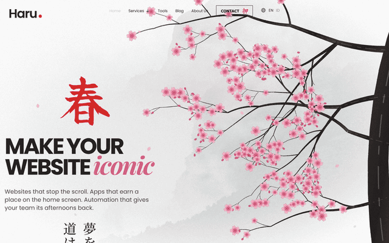

# Haru Studio: static HTML site

This is an original site with its own brand, copy, images and code. It is plain HTML, CSS and JS
with no server and no build step needed to view it.

## Opening the site
Double-click `index.html`, or serve the folder (`npx serve .`) for the most faithful behaviour. Everything
works from `file://` too, including fonts, video, page transitions and tools.

## Pages (35)
| Page | File |
|---|---|
| Home | `index.html` |
| Services ×4 | `services/website-design.html`, `ecommerce-development.html`, `app-development.html`, `business-ai.html` |
| City landing ×6 | `services/website-design/{jakarta,singapore,sydney}.html`, `services/app-development/{…}.html` |
| Project detail ×8 | `services/<service>/<project>.html` (reef-log, nusa-cup, fan-pass, tidewater, harvest-night, move-daily, free-the-bay, tumbuh) |
| Blog + 9 articles | `blog.html`, `blog/<slug>.html` |
| Tools index | `tools.html` (links to `tools/website-cost-calculator` and `tools/critical-css-generator`, which are not in this folder yet) |
| About, Contact, Privacy, Terms, 404 | `about-us.html`, `contact.html`, `privacy-policy.html`, `terms-of-service.html`, `404.html` |

## States and interactions
- **Intro on the home page.** The landscape fades in, a procedural sakura branch grows and blooms, the 春
  kanji is written stroke by stroke, then the nav appears.
- **Rotating hero word.** The accent word dissolves into canvas petals.
- **Header.** A blurred backdrop appears once you scroll. The nav hides over the sticky service posters.
  - The **Services** dropdown is a full-width panel with service posters.
  - The **mobile menu** has a services accordion.
- **Cursor.** A custom circle labelled "Visit" or "Play" appears on hover. There is also a scroll indicator
  and a page transition (the page slides up and scales) between pages.
- **Studio reel.** Clicking it opens the video full screen with sound (the only element with audio).
  It has a close button and a magnetic play button.
- **Service posters.** They stack sticky and the incoming one rotates in.
- **Reveal animations, falling petals and the dancer.** Titles and cards reveal on scroll, petals fall in the
  background, and the dancer changes pose as you scroll.
- **FAQ accordion.** The red tassel ribbon swings to whichever answer is open.
- **Service pages.**
  - A floating "Book a call" button, a bento grid, a draggable before/after slider and a testimonial carousel.
  - A contact form with validation and a sent state.
  - A **booking modal** to pick a day and time, then a confirmation state.
- **Project pages.** A pinned horizontal gallery (vertical on mobile).
- **Blog articles.** Like and share buttons, plus code blocks with a copy button.
- **Tools.** `assets/js/tools.js` implements a cost calculator (live price, line items, "AI-only" warning,
  printable PDF) and a critical CSS generator (extracts above-the-fold CSS in a hidden iframe, nothing is
  uploaded). Their pages under `tools/` are not present in this folder, so the links on `tools.html` 404.

Forms and bookings are demos: they never send data anywhere.

## Editing
This folder holds only the built output, so edit the `.html` files and assets directly.
- The generator that produced them is not here: `_build/` (copy in `data.mjs`, `articles.mjs`, page
  templates, `build.mjs`, `mocks.mjs`), and `docs/` are missing. Restore them before relying on
  `node _build/build.mjs`, which would rewrite every `.html` file.
- CSS is in `assets/css/`:
  - `main.css`: tokens and chrome
  - `pages.css`: home
  - `inner.css`: service components
  - `more.css`: other pages
  - `fonts.css`: local `@font-face` rules
- JS is in `assets/js/`: `main.js`, `home.js`, `pages.js` and `tools.js`.

## Placeholders to replace
- **Contact details.** The brand "Haru Studio", `hello@haru.studio`, `+62 361 000 2410`, the WhatsApp link
  and the Canggu address are all placeholders.
- **People and clients.** Team members, clients, projects, testimonials and statistics are fictional.
- **Language switch.** The ID button only shows a "coming soon" toast; only English is published.
- **Social links.** LinkedIn and Instagram point to the generic homepages.

## Media and licences
Credits are listed in `assets/CREDITS.json`.
- **Photos.** All are free Unsplash photos (Unsplash License). The cut-out figures were made with rembg.
- **Reel.** The video is "City of Tokyo at night" from Mixkit, with the music track "Kodama Night Town" from
  Mixkit muxed in, both under the Mixkit License.
- **Fonts.** These are local copies of Google Fonts (OFL): Poppins, Playfair Display, Kanit, and subsets of
  Noto Serif JP and Yuji Boku.
- **Source media.** Raw photos and the original video and music were kept in `_build/source-media/`, which
  is not in this folder.

## Design notes
- **Illustrations.** Photographic cut-outs from Unsplash, so the style is collage-like rather than painted.
- **Sakura branch.** It is generated procedurally in SVG, not hand-drawn.
- **Kanji.** The 春 is the Yuji Boku glyph revealed with a brush-order mask, not a traced stroke drawing.
- **Page transition.** This site uses separate HTML files, so the transition is emulated: the old page slides out, a paper
  panel follows, then the new page slides in on load.
- **Spanish locale.** There is no second language.
